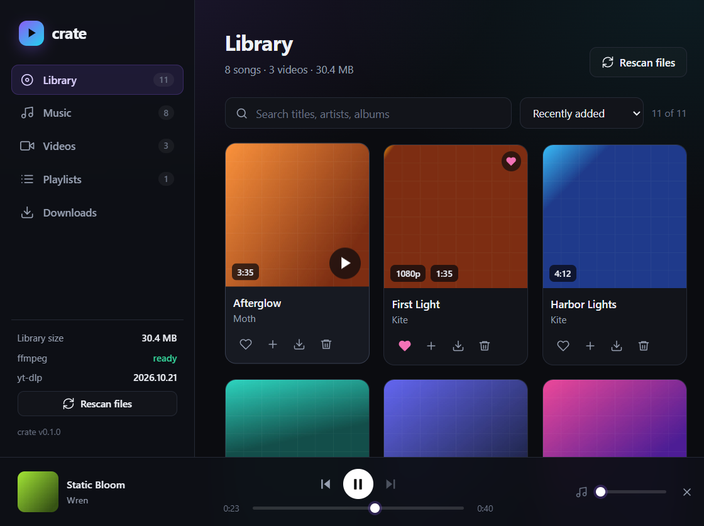
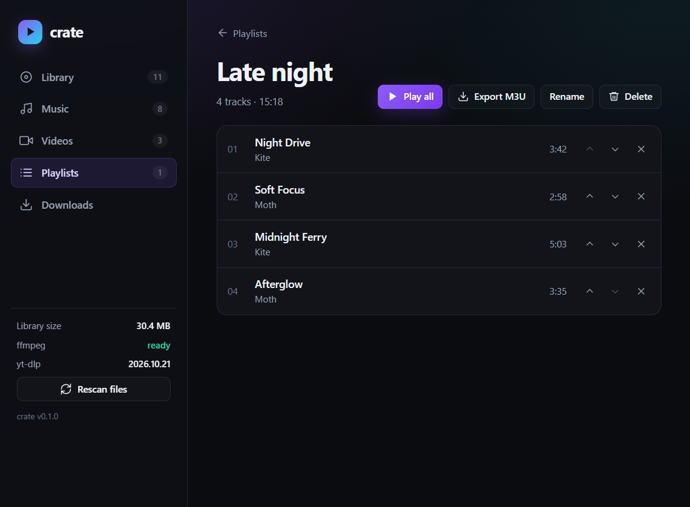
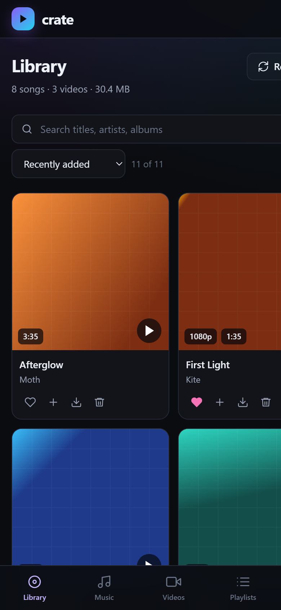

# crate

**Paste a link → get an MP3 or MP4 → keep it in a library you can play from your phone.**

`crate` is a self-hosted downloader and media library. It wraps `yt-dlp` with a durable job
queue, stores everything in a plain folder on disk, and serves a mobile-first web app for
browsing, streaming, and organizing it. No accounts, no cloud, no subscription.



| Playlists | Mobile |
| --- | --- |
|  |  |

## What it does

- **Downloads** — paste a video or playlist-item URL, choose **MP4** (up to 4K) or **MP3**
  (up to 320 kbps), and follow progress live.
- **Keeps a real library** — files stay as ordinary `library/audio/*.mp3` and
  `library/video/*.mp4`. Metadata lives next to each file in a small
  `<name>.crate.json` sidecar, so the library survives database loss.
- **Streams anywhere on your network** — HTML5 playback with HTTP Range support, so seeking
  works and mobile Safari/Chrome can play without downloading the whole file.
- **Playlists** — create, reorder, rename, and export as `.m3u`.
- **Favorites, search, and sorting** — by recent, title, duration, or play count.
- **Picks up files you add by hand** — a rescan indexes dropped files, including ones with
  no metadata.
- **Survives restarts** — jobs are rows in SQLite; interrupted work is marked failed and can
  be retried instead of vanishing.

## Quickstart

Requirements: **Python 3.11+** (built on 3.12) and **Node 20+** for the UI build.
`ffmpeg` is bundled through `imageio-ffmpeg`, so you do not need to install it separately.

```bash
git clone https://github.com/Fararouille/Music-Video-downloader.git
cd Music-Video-downloader

python -m venv .venv
source .venv/bin/activate          # Windows: .venv\Scripts\activate
pip install -e ".[dev]"

cd frontend
npm ci
npm run build
cd ..

crate serve
```

Open <http://127.0.0.1:8000>. The API and the built UI are served from the same port.

Want something to look at first? Generate a demo library of test tones and clips:

```bash
python scripts/seed_demo.py
crate serve
```

`crate info` prints the resolved paths, media counts, and whether ffmpeg/yt-dlp were found.

## Downloading

In the **Downloads** view, paste a URL and pick a format:

| Format | Choices | Default |
| --- | --- | --- |
| MP4 video | `best`, `2160`, `1440`, `1080`, `720`, `480`, `360` | `1080` |
| MP3 audio | `320`, `192`, `128` kbps | `192` |

Video downloads prefer the best stream at or below the chosen height and remux to MP4 when
ffmpeg is available. Audio downloads extract to MP3 with `libmp3lame`.

The queue runs one download at a time on a worker thread. Jobs can be cancelled, retried,
or removed from the history. Files are deduplicated by source id: downloading the same video
again replaces the file while keeping its playlists, favorites, and play count.

## Using it from your phone

By default `crate` binds to loopback only. To reach it from other devices:

```bash
# A long random value; this is the only password.
export CRATE_TOKEN="$(python -c 'import secrets; print(secrets.token_urlsafe(24))')"
crate serve --host 0.0.0.0 --port 8000
```

On Windows PowerShell:

```powershell
$env:CRATE_TOKEN = "a-long-random-string"
crate serve --host 0.0.0.0
```

Then open `http://<your-computer-lan-ip>:8000` on the phone and paste the token once. The
server trades it for an HttpOnly session cookie; API clients can also send
`Authorization: Bearer <token>`.

> **Security note:** the token protects the app, not the wire. Plain HTTP is fine on a
> trusted home LAN. On shared or untrusted networks, put `crate` behind a TLS reverse proxy
> (Caddy, Tailscale Serve, nginx) and set `CRATE_SECURE_COOKIES=1`.

## Android app

Phones cannot install the web app as a PWA over plain HTTP, because a LAN address is not a
secure context. For that case there is a small Android shell in [`android/`](android/).

Grab the APK from the [latest release](https://github.com/Fararouille/Music-Video-downloader/releases/latest),
open it on the phone, and allow installs from your browser or file manager when Android asks.
The app needs Android 8.0 or newer.

On first launch it asks for the server address, for example:

```
http://192.168.1.42:8000
```

After that it loads the normal `crate` web interface, so the token login works exactly as it
does in a browser. Press Back from the library to change the address later.

The app is a WebView shell, not a second implementation: the library, the download queue, and
all media stay on your server, so playback needs the server to be reachable. Files you save
from the library go to `Downloads/crate` through Android's download manager. Builds from the
release workflow are debug APKs signed with the standard debug key — fine for personal use,
but not something you can publish to the Play Store as-is.

## Docker

```bash
docker compose up --build -d
# http://localhost:8000
```

The compose file uses two named volumes (`crate-library`, `crate-data`). To keep media in a
host folder instead, replace them with bind mounts and give the container user write access:

```yaml
volumes:
  - ./library:/library
  - ./data:/data
```

```bash
sudo chown -R 10001:10001 library data   # Linux only
```

Or without compose:

```bash
docker build -t crate .
docker run --rm -p 8000:8000 \
  -e CRATE_TOKEN=change-me \
  -v crate-library:/library -v crate-data:/data \
  crate
```

## Configuration

All settings are environment variables, read at startup.

| Variable | Default | Purpose |
| --- | --- | --- |
| `CRATE_HOST` | `127.0.0.1` | Bind address. Use `0.0.0.0` for LAN access. |
| `CRATE_PORT` | `8000` | HTTP port. |
| `CRATE_LIBRARY` | `./library` | Media root. Subfolders `audio/`, `video/`, `thumbnails/` are managed automatically. |
| `CRATE_DB` | `./data/crate.db` | SQLite database path. |
| `CRATE_TOKEN` | empty | Enables single-user auth. Anything non-empty is treated as the password. |
| `CRATE_ALLOW_PRIVATE_URLS` | `0` | Allow downloads from loopback/private addresses (tests, LAN media servers). |
| `CRATE_COOKIES` | empty | Path to a Netscape-format cookies file for `yt-dlp`. |
| `CRATE_FFMPEG` | auto | Explicit ffmpeg path; otherwise `PATH`, then the `imageio-ffmpeg` binary. |
| `CRATE_FRONTEND` | repo `frontend/dist` | Directory containing a built `index.html`. |
| `CRATE_SECURE_COOKIES` | `0` | Mark the session cookie `Secure`; use behind HTTPS. |

Some sites need cookies or a login to access higher-quality streams. Export cookies from
your browser with a `cookies.txt` extension, then point `CRATE_COOKIES` at the file.

## How it works

```text
React PWA (Vite + TypeScript)
      │  JSON, Range requests, cookie or Bearer auth
      ▼
FastAPI ──────────────► SQLite: media, playlists, playlist_items, jobs
   │
   ├─ library scanner ── sidecars + ffprobe/ffmpeg metadata
   │
   ├─ job worker thread ── yt-dlp ── ffmpeg
   │        │
   │        └─ library/audio, library/video, library/thumbnails
   │
   └─ Range streaming (206 Partial Content)
```

A few deliberate choices:

- **One worker thread.** Downloads are I/O-heavy; parallel downloads tend to make every
  transfer slower. Jobs remain visible and cancelable while queued.
- **Files are the source of truth.** SQLite is an index, and every row can be rebuilt by
  scanning the folders. Media ids are `sha1(relative path)[:16]`, stable across rescans.
- **Streaming, not transcoding.** The original file is served as-is with byte ranges. That
  keeps CPU usage near zero and preserves quality.
- **SSRF guard on by default.** `yt-dlp` will fetch arbitrary URLs, so the API rejects
  loopback, private, link-local, and reserved addresses unless
  `CRATE_ALLOW_PRIVATE_URLS=1` is set.

### API

`GET /api/health` is public. Everything else requires the token when `CRATE_TOKEN` is set.
Interactive docs are available at `/docs`.

| Method | Path | Purpose |
| --- | --- | --- |
| `GET` | `/api/health` | Version, counts, ffmpeg/yt-dlp availability |
| `GET` | `/api/session` | Whether auth is required and the caller is authenticated |
| `POST` | `/api/login`, `/api/logout` | Exchange the token for a session cookie / clear it |
| `GET` | `/api/media` | List media (`kind`, `q`, `sort`, `favorite`, `limit`) |
| `GET/PATCH/DELETE` | `/api/media/{id}` | Fetch, edit title/artist/album/favorite, delete |
| `GET` | `/api/media/{id}/stream` | Stream with Range support |
| `GET` | `/api/media/{id}/file` | Download as an attachment |
| `GET` | `/api/media/{id}/thumb` | Cached thumbnail |
| `POST` | `/api/media/{id}/played` | Record a play |
| `POST` | `/api/library/scan` | Re-scan the library folders |
| `GET/POST` | `/api/playlists` | List or create playlists |
| `GET/PATCH/DELETE` | `/api/playlists/{id}` | Fetch, rename, or delete a playlist |
| `POST/DELETE` | `/api/playlists/{id}/items` | Add or remove a track |
| `PATCH` | `/api/playlists/{id}/order` | Reorder all tracks |
| `GET` | `/api/playlists/{id}/m3u` | Export `.m3u` with absolute file paths |
| `POST/GET` | `/api/downloads` | Enqueue a download or list job history |
| `POST` | `/api/downloads/{id}/cancel`, `/retry` | Cancel or retry a job |
| `DELETE` | `/api/downloads/{id}` | Remove a finished job from history |

Example:

```bash
curl -X POST http://127.0.0.1:8000/api/downloads \
  -H "Content-Type: application/json" \
  -d '{"url": "https://www.youtube.com/watch?v=...", "kind": "audio", "quality": "320"}'
```

## Tests and quality

```bash
pytest                          # 105 backend tests
ruff check src tests scripts
ruff format --check src tests scripts
python scripts/e2e_download.py  # real download + streaming check
cd frontend && npm run build    # TypeScript strict + Vite production build
```

The suite covers URL validation and the SSRF guard, library scanning and sidecars,
download registration/replacement, playlists, Range streaming, auth, the HTTP API, job
state transitions, and configuration parsing. CI runs the backend suite, lint, and the
end-to-end script on Linux, and builds the UI on every push.

The end-to-end script generates an MP4 with ffmpeg, serves it from loopback, starts `crate`
with private URLs enabled, and enqueues an MP4 and an MP3 job through the real API. It then
checks that both jobs finish, metadata is probed from the files, the items are indexed, the
sidecars exist, and `Range: bytes=0-99` returns `206 Partial Content` with 100 bytes. No
internet access is required.

Not covered by automated tests: a live download from YouTube in CI (network-dependent,
and site behavior changes independently of this code), and real-device browser testing.

The Android shell is built separately by the `Android APK` workflow, which runs on tags
matching `v*` and attaches the resulting debug APK to the release.

## Limits and non-goals

- **Single user.** The token is one shared password, not user accounts.
- **One download at a time.** Simple and predictable; a small job queue rather than a
  download manager.
- **No DRM.** `yt-dlp` cannot and will not bypass DRM-protected services.
- **No transcoding.** MP3 extraction only; video is remuxed, not re-encoded.
- **SQLite + local disk.** Great for tens of thousands of tracks on one machine, not a
  multi-tenant service.
- **M3U export uses server-side absolute paths**, which is what desktop players on the same
  machine need. In Docker those paths point inside the container; use the stream API instead.

## Legal

`crate` is a tool for downloading media you have the right to download — your own uploads,
public-domain and Creative Commons material, or content whose license permits it. Downloading
copyrighted media can violate the source site's terms of service and local law. You are
responsible for how you use it.

## License

MIT — see [LICENSE](LICENSE).
